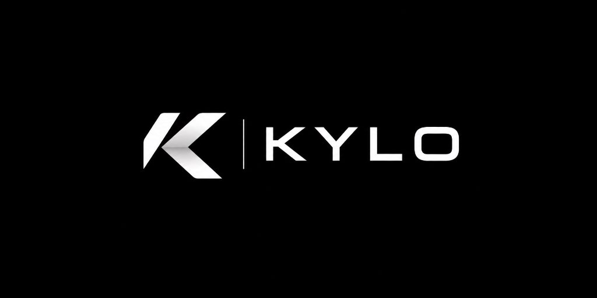
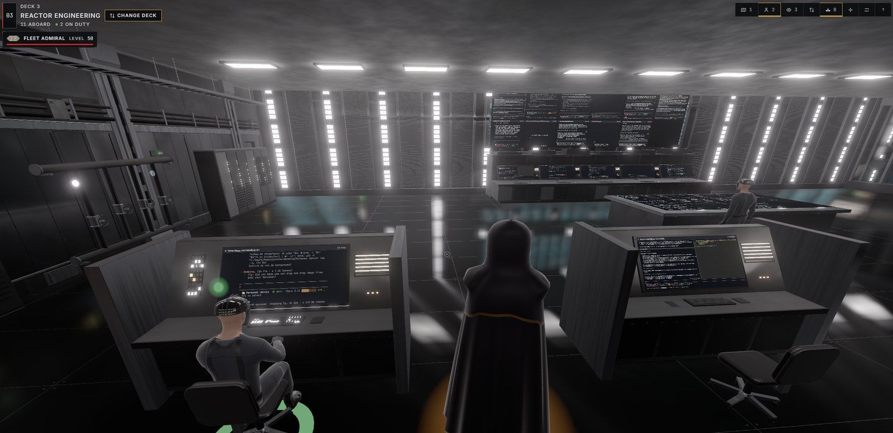
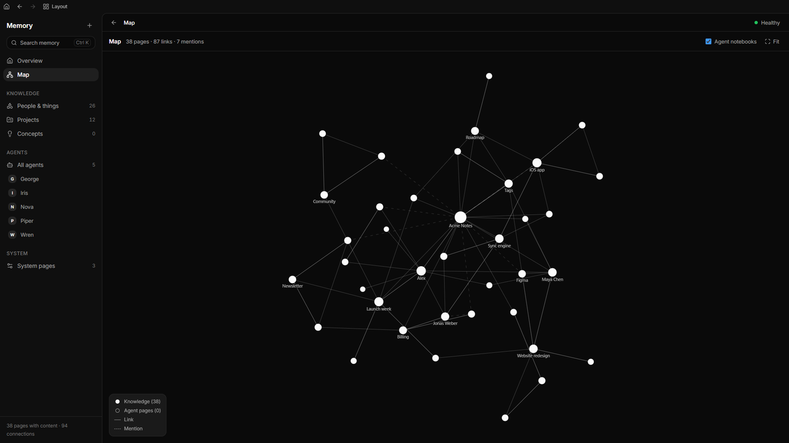
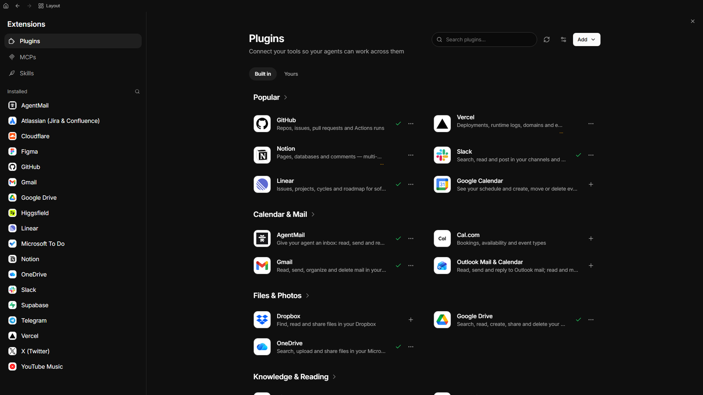
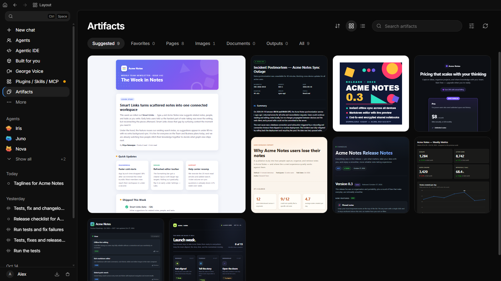
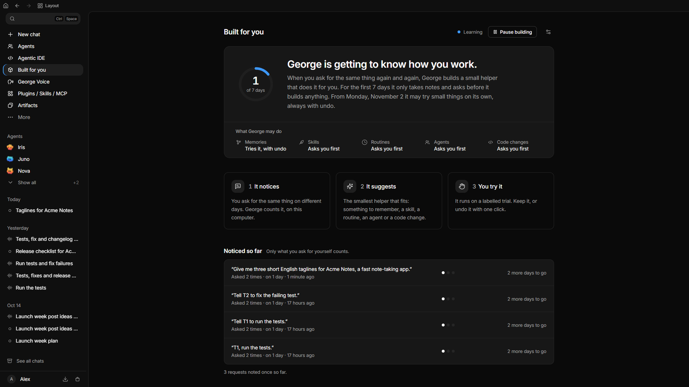
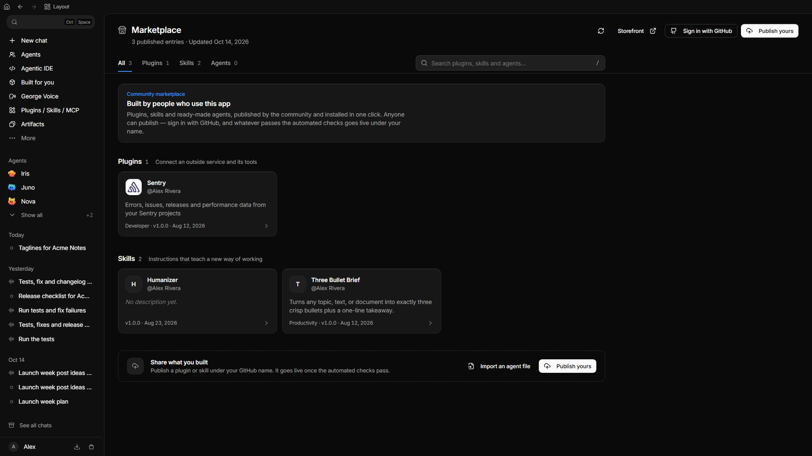

<p align="center">
  
</p>

<h1 align="center">Kylo</h1>

<p align="center">
  <strong>English</strong> ·
  <a href="README.zh-CN.md"</a>
</p>

<p align="center"><strong>Kylo is an open-source agent OS for your desktop: it runs your coding agents, browser and apps by voice or chat, on your own machine.</strong></p>

<p align="center">
  <a href="LICENSE"></a>
</p>

<p align="center">
  <a href="#install"><strong>Install</strong></a> ·
  <a href="#code-by-talking">Code by talking</a> ·
  <a href="#run-every-coding-agent-at-once">Agentic IDE</a> ·
  <a href="#a-team-of-agents">Agents</a> ·
  <a href="docs/product/start-here/welcome-to-kylo.md">Docs</a>
</p>

Kylo adds a Groq brain provider (every chat model Groq hosts, on the same
`GROQ_API_KEY` used for Groq speech recognition), the 4B Nemotron
(`nvidia/nemotron-3.5-bolt-e4b`) in the NVIDIA NIM model list, and a Research
IDE with MongoDB-backed run history. It ships without bundled skills or
marketplace plugins; add your own under the user skills directory.

Kylo is a modified fork of an Apache-2.0 open-source project; see
[NOTICE](NOTICE) for attribution and [LICENSE](LICENSE) for the license.

**Yours, with no catch.** Kylo runs on Windows, macOS, Linux or a server
without a screen. There is no account, no paid tier and no cloud of ours between
you and your models: bring one API key, the Claude or ChatGPT plan you already
pay for, or a local model. Every action that could change your system waits for
your approval.

## Install

```powershell
# Windows (PowerShell)
irm https://raw.githubusercontent.com/charanbalaji2005/Kylo/main/install/install.ps1 | iex
```

```bash
# macOS and Linux
curl -fsSL https://raw.githubusercontent.com/charanbalaji2005/Kylo/main/install/install.sh | bash
```

Nothing to install first, no GPU needed. The installer opens the app, and you
pick your language, wake phrase and model there. Desktop installers and the
server setup are under [more ways to install](#more-ways-to-install).

## Why Kylo

- **Local, no account.** The app and your data stay on your machine.
- **Any model or subscription.** Hosted models, local models through Ollama, or your Claude and ChatGPT plans.
- **Many coding agents side by side.** Claude Code, Codex, OpenCode and more in live panes you can watch and steer.
- **Voice.** Your own wake phrase, live conversations and dictation, with speech recognition that can run offline.

|  | Kylo | Coding-agent CLIs in separate terminals | Hosted chat assistants |
|---|---|---|---|
| Runs on your machine | Yes. Models can be local or hosted | The CLI runs locally, the model is usually hosted | No, it runs in the provider's cloud |
| Several coding agents side by side | Yes, in live panes with call signs (T1, T2) | One terminal per agent, switched by hand | No coding-agent panes |
| Voice | Wake phrase, live conversation, dictation | Varies by tool | Varies by provider |
| Open source | Yes, Apache 2.0 | Varies: Codex CLI and OpenCode are, Claude Code is not | Usually not |

## Code by talking

https://github.com/user-attachments/assets/1daa832e-a566-4f22-add6-8b21eb8aaaad

Talk to Kylo and it hands the work to your coding agents. In this recording
(made before the rename) one spoken sentence starts a new Claude Code session
that digs into the app's performance. In the Agentic IDE every pane has a call
sign, so you can also say "T1, run the tests" or "T2, fix whatever T1 finds".
Kylo turns each sentence into a full, project-aware brief, asks first when a
call sign is unclear, and the work keeps going after you hang up.
[How it works](https://github.com/charanbalaji2005/Kylo/blob/main/docs/product/extend-and-automate/agentic-ide.md#send-clear-work)

## Run every coding agent at once

https://github.com/user-attachments/assets/83c50d16-8c3c-420f-baab-e6d06381307b

The Agentic IDE turns one screen into a room full of coding agents. Open a
project, split it into panes and start any coding tool you have installed in each
one, on the subscriptions you already pay for. Diffs, an editor, Git and pull
requests sit next to the panes, so you review every line before it lands, and
every pane stays a real terminal you can type into.
[Agentic IDE guide](https://github.com/charanbalaji2005/Kylo/blob/main/docs/product/extend-and-automate/agentic-ide.md)

## A team of agents

https://github.com/user-attachments/assets/4c29df69-2114-4ed1-a220-703f6ff8386a

Create specialists with one click: a researcher, a release manager, a writer.
Each agent keeps one chat that never ends, learns from its own work, runs
routines on a schedule and puts what it makes in Artifacts, with every tool call
visible. Agents can also run on Hermes and OpenClaw.
[Agents guide](https://github.com/charanbalaji2005/Kylo/blob/main/docs/product/extend-and-automate/kylo-agents.md)

## Everything else

<table>
  <tr>
    <td width="50%" valign="top"><br /><b>Verse</b><br />Your agents live on a ship you can walk through, see who is on duty and who needs you. <a href="https://github.com/charanbalaji2005/Kylo/blob/main/docs/verse/README.md">Verse</a></td>
    <td width="50%" valign="top"><br /><b>Memory</b><br />A local wiki that your agents read, write and cite, with a map of everything it knows. <a href="https://github.com/charanbalaji2005/Kylo/blob/main/docs/product/knowledge-and-sharing/wiki-and-memory.md">Memory</a></td>
  </tr>
  <tr>
    <td width="50%" valign="top"><br /><b>Plugins, MCP and skills</b><br />More than 40 one-click integrations, any MCP server, command-line tools and reusable skills. <a href="https://github.com/charanbalaji2005/Kylo/blob/main/docs/product/extend-and-automate/plugins.md">Plugins</a></td>
    <td width="50%" valign="top"><br /><b>Artifacts</b><br />Every page, report and dashboard your agents make, in one wall. <a href="https://github.com/charanbalaji2005/Kylo/blob/main/docs/product/extend-and-automate/kylo-agents.md">Agents guide</a></td>
  </tr>
  <tr>
    <td width="50%" valign="top"><br /><b>Built for you</b><br />Kylo notices what you keep doing and builds what takes it off you: a skill, a routine or an agent. You can see and undo all of it. <a href="https://github.com/charanbalaji2005/Kylo/blob/main/docs/self-build.md">How it works</a></td>
    <td width="50%" valign="top"><br /><b>Marketplace</b><br />Agents, skills and plugins from the community, installed with one click. <a href="https://github.com/charanbalaji2005/Kylo/blob/main/docs/marketplace/community-registry.md">Marketplace</a></td>
  </tr>
</table>

Also built in: **voice** with your own wake phrase, live conversations, dictation and phone calls ([voice guide](https://github.com/charanbalaji2005/Kylo/blob/main/docs/product/everyday-use/voice-conversations.md)); **computer use** for your desktop and browser ([computer use](https://github.com/charanbalaji2005/Kylo/blob/main/docs/product/extend-and-automate/computer-use.md)); and **approvals**: every action passes a risk check (safe, monitor, ask, block) and every run is recorded ([safety](https://github.com/charanbalaji2005/Kylo/blob/main/docs/product/privacy-safety-and-support/safety-and-approvals.md)). Works with OpenAI, Claude, Gemini, OpenRouter, NVIDIA, Ollama and any OpenAI-compatible server, and with Claude Code, Codex, OpenCode, Kimi Code, GLM, Grok Build, Antigravity, Cursor CLI and DeepSeek Harness.

## More ways to install

If Python or Git is missing, the one-line installer downloads a private copy
just for Kylo, without administrator rights. Run it again to update. After
it has run, start Kylo from the desktop launcher or a terminal:

```bash
kylo         # full desktop
```

Prefer a regular installer?
[Windows (x64)](https://github.com/charanbalaji2005/Kylo/releases/latest/download/Kylo-Setup-x64.exe) ·
[macOS (Apple Silicon)](https://github.com/charanbalaji2005/Kylo/releases/latest/download/Kylo-macOS-arm64.dmg) ·
[macOS (Intel)](https://github.com/charanbalaji2005/Kylo/releases/latest/download/Kylo-macOS-x64.dmg) ·
[Linux (AppImage, x86_64)](https://github.com/charanbalaji2005/Kylo/releases/latest/download/Kylo-Linux-x86_64.AppImage).
The macOS disk image is not notarized yet: on first launch, open **System
Settings > Privacy & Security** and click **Open Anyway**. Windows installers
are signed under our [code signing policy](https://github.com/charanbalaji2005/Kylo/blob/main/docs/code-signing-policy.md)
once the SignPath Foundation program approves the project. Free code signing
provided by SignPath.io, certificate by SignPath Foundation.

On a server, run `pip install kylo` and `kylo serve`, then open
`http://localhost:47821`. The [headless deployment guide](https://github.com/charanbalaji2005/Kylo/blob/main/docs/headless-vps-deployment.md)
covers HTTPS for remote microphones and the
[native package index](https://github.com/charanbalaji2005/Kylo/blob/main/docs/product/start-here/install-kylo.md#install-the-isolated-pypi-package)
needed for pip on Intel Macs and Windows ARM64.

## Docs

| Goal | Start here |
|---|---|
| Get started | [First run](https://github.com/charanbalaji2005/Kylo/blob/main/docs/product/start-here/first-run-setup.md) · [App tour](https://github.com/charanbalaji2005/Kylo/blob/main/docs/product/start-here/desktop-app-tour.md) |
| Talk and dictate | [Voice](https://github.com/charanbalaji2005/Kylo/blob/main/docs/product/everyday-use/voice-conversations.md) · [Dictation](https://github.com/charanbalaji2005/Kylo/blob/main/docs/product/everyday-use/dictation.md) |
| Agents and automation | [Agentic IDE](https://github.com/charanbalaji2005/Kylo/blob/main/docs/product/extend-and-automate/agentic-ide.md) · [Agents](https://github.com/charanbalaji2005/Kylo/blob/main/docs/product/extend-and-automate/kylo-agents.md) · [Routines](https://github.com/charanbalaji2005/Kylo/blob/main/docs/routines.md) · [MCP](https://github.com/charanbalaji2005/Kylo/blob/main/docs/product/extend-and-automate/mcp-connections.md) · [CLI](https://github.com/charanbalaji2005/Kylo/blob/main/docs/kylo-cli.md) |
| Models | [Providers](https://github.com/charanbalaji2005/Kylo/blob/main/docs/product/personalize-and-connect/providers-and-api-keys.md) · [Local models](https://github.com/charanbalaji2005/Kylo/blob/main/docs/product/personalize-and-connect/local-ai-providers.md) |
| Run and fix | [Server](https://github.com/charanbalaji2005/Kylo/blob/main/docs/headless-vps-deployment.md) · [Architecture](https://github.com/charanbalaji2005/Kylo/blob/main/docs/architecture-overview.md) · [Troubleshooting](https://github.com/charanbalaji2005/Kylo/blob/main/docs/product/privacy-safety-and-support/troubleshooting.md) · [Privacy](https://github.com/charanbalaji2005/Kylo/blob/main/docs/product/privacy-safety-and-support/privacy-and-local-data.md) |


A star on GitHub helps other people find Kylo. Sponsors are listed in [SPONSORS.md](https://github.com/charanbalaji2005/Kylo/blob/main/SPONSORS.md).


## License

[Apache 2.0](https://github.com/charanbalaji2005/Kylo/blob/main/LICENSE). Releases up to and including 1.6.0 keep their original MIT license. See [NOTICE](https://github.com/charanbalaji2005/Kylo/blob/main/NOTICE) and the [trademark guidance](https://github.com/charanbalaji2005/Kylo/blob/main/TRADEMARK.md).
